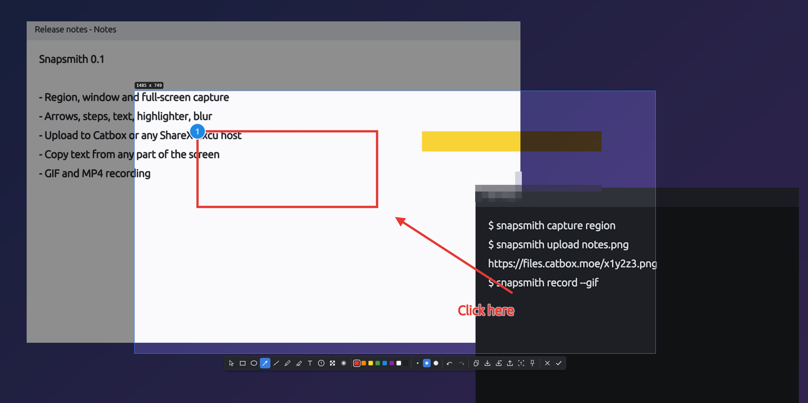
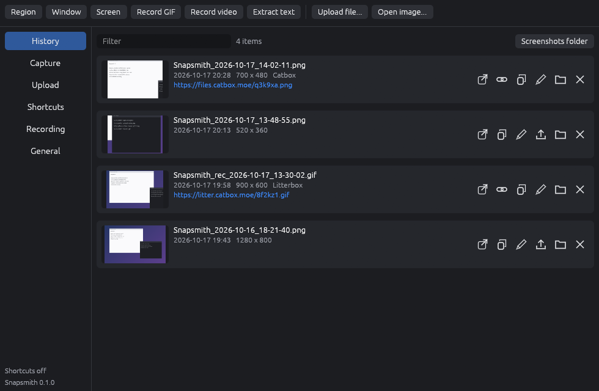

<p align="center"></p>

<h1 align="center">Snapsmith</h1>

<p align="center">Screenshots, annotation, uploads, text recognition and GIF recording for Windows, macOS and Linux.<br>
ShareX-style workflows in one small native program, and it reads ShareX <code>.sxcu</code> custom uploaders.</p>

<p align="center"><a href="https://github.com/fsiuhgshiqoih32/snapsmith/releases/latest">Download</a> ·
<a href="#usage">Usage</a> · <a href="#custom-uploaders">Custom uploaders</a> · <a href="#building">Building</a></p>



## Why

ShareX is the screenshot tool people miss most when they leave Windows. Snapsmith brings its way of
working to every desktop: press a key, pick an area on a frozen screen, mark it up, and have it
copied, saved and uploaded in one go. Hosts you already use with ShareX work unchanged, because
Snapsmith imports the same `.sxcu` files.

## Features

- **Capture** a region (drag, or click a window to take it), the focused window, the monitor under
  the pointer, or every screen at once. Optional delay.
- **Region selection** on a frozen frame with a magnifier, pixel colour readout (C copies it),
  window snapping, resize handles and arrow-key nudging.
- **Annotate** in place: rectangle, ellipse, arrow, line, pen, highlighter, text, numbered steps,
  pixelate and blur. Shift keeps shapes square and lines at 45°. Undo and redo.
- **After-capture tasks** like ShareX: copy, save (with file name patterns such as
  `%y-%mo/Shot_%h-%mi-%s`), upload and copy the link, recognise text, pin to screen, notify.
- **Upload** to Catbox or Litterbox out of the box, or to any host with a ShareX custom uploader.
  Upload any file from the window or the command line.
- **Text recognition (OCR)** of any area, entirely on your computer (ocrs). The model files
  (12 MB) are downloaded once, after you agree.
- **Record** an area as a GIF (built in) or MP4 (with ffmpeg), with the pointer drawn in.
- **Pin** a capture to the screen as an always-on-top window.
- **Editor** for existing images: the same tools plus crop, zoom and pan.
- **History** of everything saved or uploaded, with thumbnails, links and quick actions.
- **Tray icon and global shortcuts**, start at login, update check.
- **Command line** for scripts and for desktops where apps can't grab keys.



## Download

Get the latest release from the [releases page](https://github.com/fsiuhgshiqoih32/snapsmith/releases/latest).

| System | File | Notes |
|---|---|---|
| Windows 10/11 (x64) | `snapsmith-vX.Y.Z-windows-x64.zip` | Unzip and run `snapsmith.exe`. |
| Windows on ARM | `snapsmith-vX.Y.Z-windows-arm64.zip` | |
| macOS 11+ (Apple silicon and Intel) | `snapsmith-vX.Y.Z-macos.zip` | Contains `Snapsmith.app`. |
| Linux x86_64 | `snapsmith-vX.Y.Z-linux-x86_64.tar.gz` | glibc 2.39 or newer (Ubuntu 24.04, Debian 13, Fedora 40 and later). Needs GTK 3, and libayatana-appindicator for the tray. |

`SHA256SUMS.txt` lists the checksums.

### First start

- **Windows.** The builds aren't code-signed, so SmartScreen may warn: choose *More info* then
  *Run anyway*. Windows 11 gives the Print Screen key to the Snipping Tool by default; Snapsmith
  tells you if that's the case. To use Print Screen for Snapsmith, turn off *Use the Print screen
  key to open screen capture* in Settings > Accessibility > Keyboard.
- **macOS.** The app is ad-hoc signed, not notarized. The first time, right-click it and choose
  *Open* (or run `xattr -dr com.apple.quarantine Snapsmith.app`). Allow Snapsmith in System
  Settings > Privacy & Security > Screen Recording when asked, then start it again.
- **Linux.** On Debian and Ubuntu: `sudo apt install libgtk-3-0 libayatana-appindicator3-1 libxkbcommon-x11-0`
  (most desktops already have them).
  Copy `snapsmith` somewhere on your `PATH` and `snapsmith.desktop` to
  `~/.local/share/applications/` if you want a menu entry.

## Usage

Start Snapsmith (with no arguments) to open its window and put an icon in the tray. Closing the
window leaves the tray icon and shortcuts running; quit from the tray menu.

### Default shortcuts

| Action | Windows and Linux | macOS |
|---|---|---|
| Capture region | Ctrl+Print Screen | Ctrl+Shift+4 |
| Capture screen | Print Screen | Ctrl+Shift+3 |
| Capture window | Alt+Print Screen | Ctrl+Shift+2 |
| Record GIF | Ctrl+Shift+Print Screen | Ctrl+Shift+5 |
| Record video | Shift+Print Screen | Ctrl+Shift+6 |
| Extract text | (none) | Ctrl+Shift+7 |

Change them in the window under *Shortcuts*. Pressing a recording shortcut again stops the
recording.

### In the selection

| Key | |
|---|---|
| Drag, or click a window | select |
| Enter, double-click | run the after-capture tasks |
| Esc, right-click | cancel |
| R E A L P H T N X B | rectangle, ellipse, arrow, line, pen, highlighter, text, step, pixelate, blur |
| V | adjust the selection |
| Ctrl+C / Ctrl+S / Ctrl+Shift+S | copy / save / save as |
| Ctrl+U / Ctrl+T / Ctrl+P | upload / copy text from the image / pin |
| Ctrl+Z / Ctrl+Y | undo / redo |
| Arrows | nudge the selection (Shift: 10 px, Alt: resize) |
| C (before selecting) | copy the colour under the pointer |
| M | magnifier on or off |

### Command line

```
snapsmith capture region            # also: screen, monitor, window
snapsmith capture screen --delay 3 --output shot.png
snapsmith capture window --tasks copy,upload
snapsmith upload report.pdf         # prints the link
snapsmith ocr                       # pick an area, copy its text
snapsmith ocr scan.png
snapsmith record --gif              # run again (or --stop) to finish
snapsmith edit image.png
snapsmith pin image.png
snapsmith import-uploader host.sxcu
snapsmith config-path
```

On **Wayland**, apps can't register global shortcuts, so bind the commands above to keys in your
desktop's keyboard settings (the same approach Flameshot uses). Screen recording isn't available on
Wayland yet, because the desktop asks for permission on every frame; it works in an X11 session.

## Custom uploaders

Snapsmith reads ShareX custom uploader files (`.sxcu`), both the current format and the older one
with `RequestType` and `$json:...$` syntax. Import one from the *Upload* page (or drop it on the
window, or run `snapsmith import-uploader file.sxcu`) and it becomes the destination.

Supported: GET, POST, PUT, PATCH and DELETE; query parameters and headers; multipart, form,
JSON, XML and binary bodies; and the response syntax `{json:path}`, `{regex:pattern|group}`,
`{response}`, `{responseurl}`, `{header:name}`, `{filename}`, `{random:a|b}`, `{base64:...}`,
including nesting. `URL`, `ThumbnailURL`, `DeletionURL` and `ErrorMessage` are read the way ShareX
reads them. Deletion links are kept in the history.

## Settings

Everything is in one TOML file; `snapsmith config-path` prints where. The window edits the same
file and the tray picks up changes within a second. Setting `SNAPSMITH_HOME` keeps settings,
history and default saves in one folder, for a portable copy.

## Building

Rust 1.95 or newer.

```
cargo build --release
```

Linux needs development packages:

```
sudo apt install libgtk-3-dev libxdo-dev libayatana-appindicator3-dev libxkbcommon-dev \
  libxcb1-dev libxrandr-dev libdbus-1-dev libpipewire-0.3-dev libclang-dev libwayland-dev \
  libegl1-mesa-dev libgbm-dev
```

`cargo test` runs the unit and integration tests (uploads are tested against a local server).
`snapsmith --self-test` opens the real windows with a scripted selection, which is what CI runs on
all three systems. `cargo run --example make_icons` regenerates the icons.

## Limitations

- macOS and Linux builds are tested in CI, including the self-test, but have had less hands-on
  use than the Windows build. Reports are welcome.
- The selection covers the monitor under the pointer; captures spanning two monitors need
  *Capture screen*.
- Text recognition reads Latin script only for now.

## Credits

Snapsmith is not affiliated with ShareX; it follows its workflow and uploader format. It is built
on [egui](https://github.com/emilk/egui), [xcap](https://github.com/nashaofu/xcap),
[ocrs](https://github.com/robertknight/ocrs), [tiny-skia](https://github.com/linebender/tiny-skia)
and other crates listed in `Cargo.toml`. Annotation text uses the Ubuntu font, under the Ubuntu
Font Licence (`licenses/UBUNTU-FONT-LICENCE.txt`).

## License

MIT. See [LICENSE](LICENSE).
